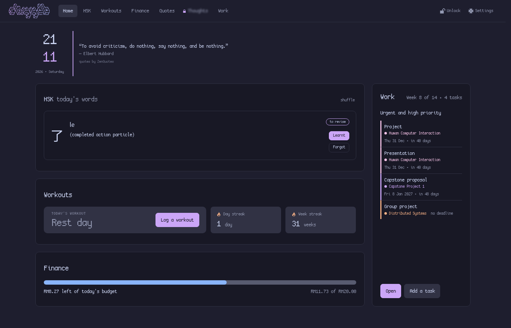
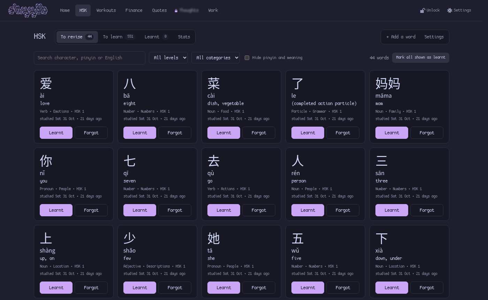
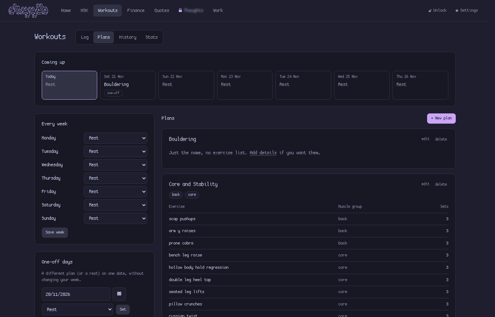
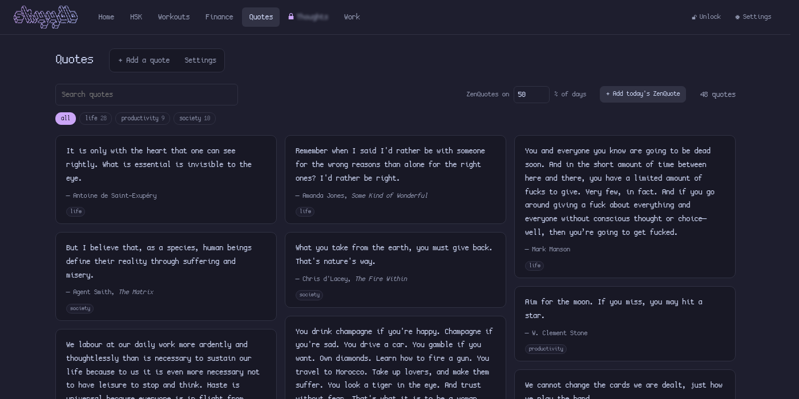
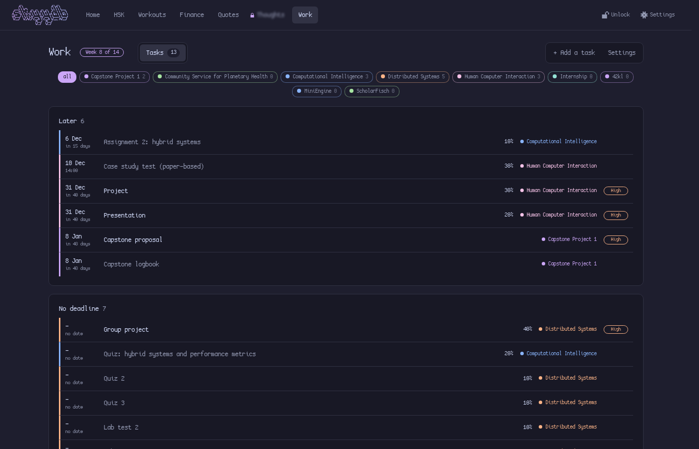
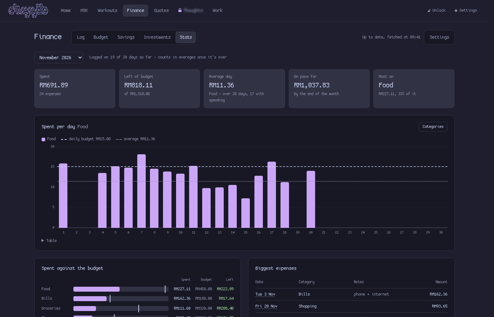
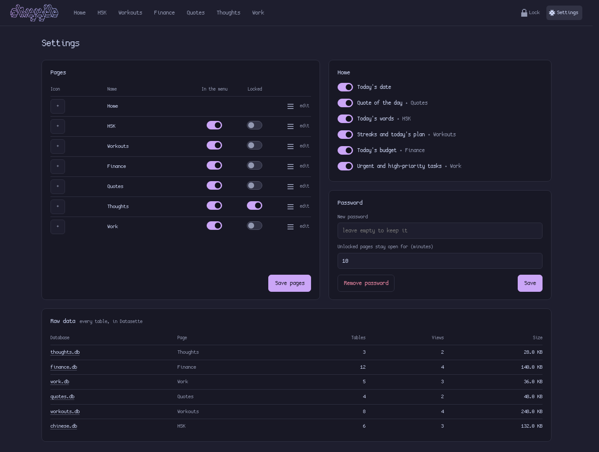

# ⛈️ skyydb

A small local web app for personal trackers, each a SQLite database, fully local and runs on your own computer at http://127.0.0.1:8001. Last time I used google sheets, but don't really feel comfortable having allat online yknow.

Choose what you like, leave what you dont 😛 also p.s. lowkey vibecoded but still useful la

ALSO! fun fact, lots of scraping and apis yummmm. Scrapes sunway elearn/outlook email, and strava. Api connection with wise and ibkr for investments. ZenQuotes api for cool quotes and stuff. And it talks to Obsidian: jot expenses in your daily notes, and your workout plans get copied into a note.

<div align="center">
  <h4>Built with ❤️ by <b>l4n1skyy (and mr. claude)</b></h4>
</div>

## Table of contents

- [What's in it](#whats-in-it)
- [Install](#install)
  - [1. Requirements](#1-requirements)
  - [2. Datasette](#2-datasette)
  - [3. skyydb](#3-skyydb)
- [Choose your features](#choose-your-features)
- [Run it](#run-it)
- [Settings](#settings)
- [Strava](#strava)
- [eLearn and Outlook](#elearn-and-outlook)
- [Expenses from Obsidian](#expenses-from-obsidian)
- [Plans in Obsidian](#plans-in-obsidian)
- [Commands](#commands)
- [Credits](#credits)



| HSK | Workouts |
|---|---|
|  |  |

| Quotes | Work |
|---|---|
|  |  |

| Finance | Settings |
|---|---|
|  |  |

## What's in it

- **Home**: today's date, a quote of the day, today's HSK words, your workout streaks and today's plan, what's left of today's budget, and your next Work tasks.
- **HSK**: Chinese words in three lists (to learn, to revise, learnt). Learnt words come back to revise after a week by themselves.
- **Workouts**: log sets (several at once, or a whole plan in one go), make plans with their own icons and put them on days of the week. Stats has a month calendar with your plan icons, a shoe on run days and your week streak, which days you train most, and your running from Strava. History lists every workout and every run. Your plans can also be copied into an Obsidian note ([Plans in Obsidian](#plans-in-obsidian)). Any list (a plan's exercises, a day's log) reorders by dragging the dash handle on the right of each row.
- **Finance**: expenses against a daily and a monthly budget (with a pie of where it went), savings balances by month, and your investments (read from Interactive Brokers and Wise if you connect them). Expenses can also be jotted in your Obsidian daily notes and logged with one command ([Expenses from Obsidian](#expenses-from-obsidian)).
- **Work**: deadlines and tasks per course, with priorities; with `elearn` installed also an Announcements tab that reads Sunway University's eLearn and Outlook.
- **Quotes** and **Thoughts**: little notebooks with tags.

Keys: Tab and Shift+Tab move between fields and buttons, as on any web page (pages are picked from the top menu). In the workout log form, Enter steps from the exercise to reps, weight and the next set, and Ctrl+Enter logs it. A drag handle with focus moves its row with the up and down arrow keys.

## Install

### 1. Requirements

Linux, Python 3.11+, SQLite and `xdg-utils` (it opens your browser). A CJK font (`noto-fonts-cjk`) is needed for Chinese characters. On Arch:

```bash
sudo pacman -S --needed python sqlite xdg-utils noto-fonts-cjk
```

### 2. Datasette

skyydb needs Datasette **1.0a41**, and the `datasette` command must end up on your PATH. Any one of these works:

```bash
# uv (sudo pacman -S uv)
uv tool install --prerelease=allow 'datasette==1.0a41'

# pipx
pipx install --pip-args=--pre 'datasette==1.0a41'

# plain pip, in a virtual environment
python -m venv ~/.venvs/datasette
~/.venvs/datasette/bin/pip install --pre 'datasette==1.0a41'
ln -s ~/.venvs/datasette/bin/datasette ~/.local/bin/datasette
```

### 3. skyydb

Clone it wherever you want your data to live: the databases and `backups/` are created inside this folder and stay out of git.

```bash
git clone https://github.com/l4n1skyy/skyydb.git
cd skyydb
ln -s "$PWD/bin/skyydb" ~/.local/bin/skyydb   # any folder on your PATH works
```

## Choose your features

The features are `chinese` (the HSK page), `workouts`, `finance`, `work`, `elearn` (Work's Announcements tab, for Sunway University students), `quotes` and `thoughts`. Install just the ones you want:

```bash
skyydb install finance workouts chinese
```

Only those get a database, a page and a spot on the dashboard. Leave the names out to install everything. Run it again any time to change the choice: the data of a feature you drop stays in its file, just hidden. `skyydb features` shows what's installed.

## Run it

```bash
skyydb             # starts the app and opens http://127.0.0.1:8001 in your browser
skyydb autostart   # optional: start it whenever you log in (skyydb autostart off undoes it)
```

Each page has a plain address: `/hsk`, `/workouts`, `/finance`, `/quotes`, `/thoughts`, `/work` and `/settings` (any case works, `/HSK` too). The raw data of each database is at `/<database>-db`, e.g. `/finance-db/expenses`.

## Settings

**Settings** (top right) is behind a password: the first time, it asks you to set one. It's where you:

- **rename pages** (the menu, their headings and Home use the new names), give them an **icon** (a searchable picker of pixel icons) and **hide** them from the menu;
- **order the menu**: drag a page by the dash handle on its row (or drag the names in the top menu itself);
- **lock pages** with a password: a locked page shows blurred in the menu, its raw data is locked too, and on Home its widget is a blank card with a lock. Opening any of them (or **Unlock** in the top right) asks for the password in a popup, and typing it once unlocks every locked page. They stay open for a few minutes after you last used the app (you choose how many); **Lock** in the top right locks them again, and so does restarting the app;
- **choose Home's widgets**, switching each on or off;
- **browse the raw data**: every database, opening Datasette's own pages (at `/<database>-db`) where you can see and edit every row.

Settings are kept in `settings.json` in this folder (out of git; the password is stored only as a scrypt hash).

## Strava

Workouts can read every activity you've logged on Strava: your running shows on its Stats tab (totals on top, a shoe on run days in the calendar, distance per week), every run is listed on History, and a run counts towards your streaks. A small scraper in [`scrapers/strava`](scrapers/strava) signs in to strava.com as you and reads your "My Activities" list (every activity, private ones too). Scraping is against Strava's terms, so it reads only your own account, slowly.

It needs [uv](https://docs.astral.sh/uv/) and Chromium (`sudo pacman -S uv chromium`). Set it up once:

```bash
cd scrapers/strava
UV_PROJECT_ENVIRONMENT=~/.local/share/venvs/strava uv sync
```

Then paste your profile link on **Workouts → Settings** and press **Sign in to Strava**: a browser window opens, you sign in (Google works too), and it reads everything. After that, opening Stats (or **Sync now**, or `skyydb strava`) adds what's new. No password is stored; your Strava cookies stay in `~/.local/share/strava/`. More in [its README](scrapers/strava/README.md).

## eLearn and Outlook

For Sunway University students: with the `elearn` feature, Work gets an **Announcements** tab that reads your eLearn (activity stream, every course's announcements and your grades) and your Outlook inbox, sorts it by how much it matters, and links deadlines to your Work tasks. The scraper is in [`scrapers/elearn`](scrapers/elearn); set it up once:

```bash
cd scrapers/elearn
UV_PROJECT_ENVIRONMENT=~/.local/share/venvs/elearn uv sync
```

Then on **Work → Settings**, under **eLearn and Outlook**, save your Sunway ID and password. They go to `~/.config/elearn/credentials`, readable by you alone, never into this folder, and the password isn't shown again. **Sign in to Outlook** opens a window once so you can approve the sign-in on your phone (Microsoft asks again about every two weeks); **Sign in to eLearn** does the same if eLearn ever wants a code. After that, **Refresh** on the Announcements tab reads everything again (about a minute). More in [its README](scrapers/elearn/README.md).

## Expenses from Obsidian

Jot expenses into your Obsidian daily notes as you go, one per line, tagged `#expenses`:

```
2.5 - Food - nasi lemak #expenses
3.5 - Household #expenses
```

That's amount, category, then a note if you like. The [Obsidian plugin](obsidian/) logs them: run **Log #expenses from daily notes** from the command palette, or click the wallet in the left ribbon. It goes through every note in your daily notes folder (`journals/daily` unless you change it in the plugin's settings), saves each line as an expense dated by its note's name (`21-11-2026` or `2026-11-21`), and takes the saved lines out of the notes. A line it can't save, like one with a category Finance doesn't have, stays in the note with `⚠ failed: why` after it; fix it and run again. It only works on the computer skyydb runs on, so lines you write on your phone get logged when you next run it there.

To install it, copy the plugin into your vault and turn it on under **Settings → Community plugins**:

```bash
mkdir -p "<your vault>/.obsidian/plugins/skyydb"
cp obsidian/main.js obsidian/manifest.json "<your vault>/.obsidian/plugins/skyydb/"
```

## Plans in Obsidian

On **Workouts → Settings**, under **Plans in Obsidian**, give the path of a note in your vault (`~/Notes/Workouts.md`, say; it's made if it isn't there yet). Every plan is written into it: a `# heading` per plan, its notes, then a table of its exercises with the columns that plan fills in (sets, reps, weight, notes). The note is rewritten whenever you add, save, reorder or delete a plan (on the Plans tab or on the raw data pages) and when the app starts. Only the part between its two `%%` marker lines is the app's, so the note's properties and anything you write above or below them stay. Change plans in skyydb: edits inside that part get overwritten.

## Commands

| Command | What it does |
|---|---|
| `skyydb` | Starts the app if needed, backs up the databases and opens the browser |
| `skyydb install [features]` | Chooses which features are installed (no names = all) |
| `skyydb features` | Lists which features are installed |
| `skyydb status` | Shows whether it's running and a summary of your data |
| `skyydb import FILE` | Imports Chinese words from a CSV, or finance data from Google Sheets exports |
| `skyydb sync` | Moves learnt HSK words you haven't studied for a while back to "to revise" (also done by itself while the app runs) |
| `skyydb backup` | Copies the databases into `backups/` (also done once a day, keeping 14) |
| `skyydb strava [all\|login]` | Reads your new Strava activities (`all`: every one again; `login`: sign in first) |
| `skyydb restart` / `skyydb stop` | Restarts or stops the app (restart after editing `plugins/app.py`) |
| `skyydb autostart` | Starts the app at login (`skyydb autostart off` undoes it) |

## Credits

Bundled in `static/fonts/`, each with its licence:

- [Pixicons](https://www.pixicons.io) (MIT): the pixel icons for pages and plans
- [HackerNoon Pixel Icon Library](https://github.com/hackernoon/pixel-icon-library) (MIT): more pixel icons
- [Cozette](https://github.com/slavfox/Cozette) (MIT): the app's small glyphs (lock, cog, tick)
- [RuneScape Quill 8](https://github.com/RuneStar/fonts) from RuneStar's Old School RuneScape fonts (CC0): the font of quotes and thoughts

Quotes come from [ZenQuotes](https://zenquotes.io), share prices from Yahoo Finance.
