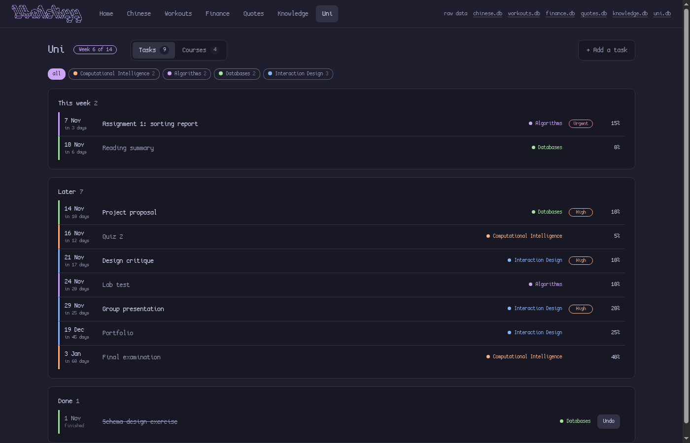

# skyydb

A small local web app for personal trackers, each a SQLite database, built on [Datasette](https://datasette.io) in [Catppuccin Mocha](https://catppuccin.com/palette) colours. It runs on your own computer at http://127.0.0.1:8001.

- **Chinese vocabulary**: three lists (to learn, to revise, learnt) with simple spaced repetition.
- **Workouts**: sets, plans, streaks, charts and personal records.
- **Finance**: expenses against daily and monthly budgets, savings and shares.
- **Uni**: courses and deadlines, ranked by priority.
- **Quotes** and **Knowledge**: notes worth keeping, with tags.


| Chinese | Workouts |
|---|---|
|  |  |

| Finance | Uni |
|---|---|
|  |  |

| Quotes |
|---|
|  |

## Install

You need Linux, Python 3.11+, SQLite, [uv](https://docs.astral.sh/uv/) and `xdg-utils`; a CJK font (`noto-fonts-cjk`) is needed for Chinese characters. On Arch:

```bash
sudo pacman -S --needed python sqlite uv xdg-utils noto-fonts-cjk
uv tool install --prerelease=allow 'datasette==1.0a41'

git clone https://github.com/l4n1skyy/skyydb.git
cd skyydb
ln -s "$PWD/bin/db" ~/.local/bin/db     # any folder on your PATH works
db install finance workouts chinese      # pick what you want (leave it out for everything)
db                                       # starts the app and opens the browser
```

**Pick your features.** The features are `chinese`, `workouts`, `finance`, `uni`, `quotes` and `knowledge`. `db install finance workouts chinese` creates only those databases, and only those get a page and a spot on the dashboard. Run it again any time to change the choice; the data of a feature you drop stays in its file, just hidden. `db features` shows what's installed.

The databases and `backups/` live inside this folder and stay out of git. Run `db autostart` once to keep the app running whenever you're logged in.

## The `db` command

| Command | What it does |
|---|---|
| `db install [features]` | Chooses which features are installed (no names = all) |
| `db features` | Lists which features are installed |
| `db` | Starts the app if needed, backs up the databases and opens the browser |
| `db status` | Shows whether it's running and a summary of your data |
| `db import FILE` | Imports Chinese words from a CSV, or finance data from Google Sheets exports |
| `db backup` | Copies the databases into `backups/` (also done once a day, keeping 14) |
| `db restart` / `db stop` | Restarts or stops the app (restart after editing `plugins/app.py`) |
| `db autostart` | Starts the app at login (`db autostart off` undoes it) |

## How it's built

- `bin/db`: the command above.
- `schema/*.sql`: tables, views and triggers, applied on every run.
- `plugins/app.py`: the pages, charts and colours (a Datasette plugin).
- `templates/`, `static/`: the pages, styles and browser code.
- `datasette.yaml`, `metadata.yaml`: Datasette settings.

On the home page, today's Chinese words start face down: click one to flip it over. The l4n1skyy logo at the top left is the menu's home link. **Tab** and **Shift+Tab** cycle through the pages in the top menu, even from a form field.

Datasette only listens on 127.0.0.1, so nothing outside your computer can reach the app. The **.db** links in the top bar open Datasette's own pages, where you can browse, query and edit every table.
