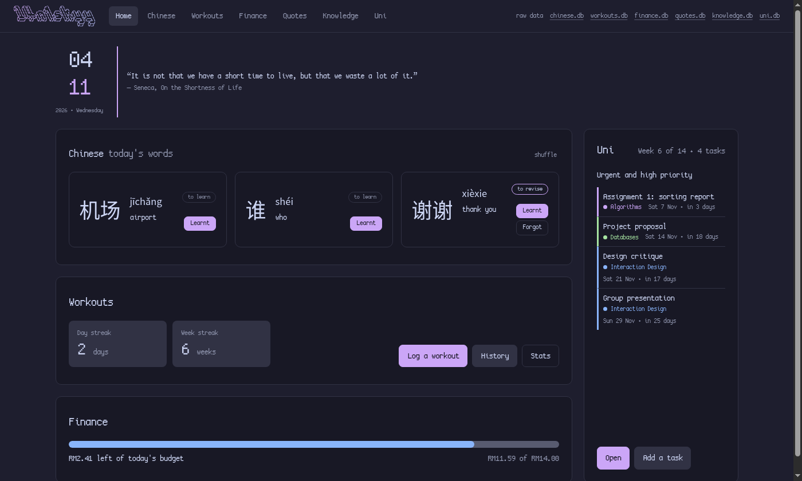
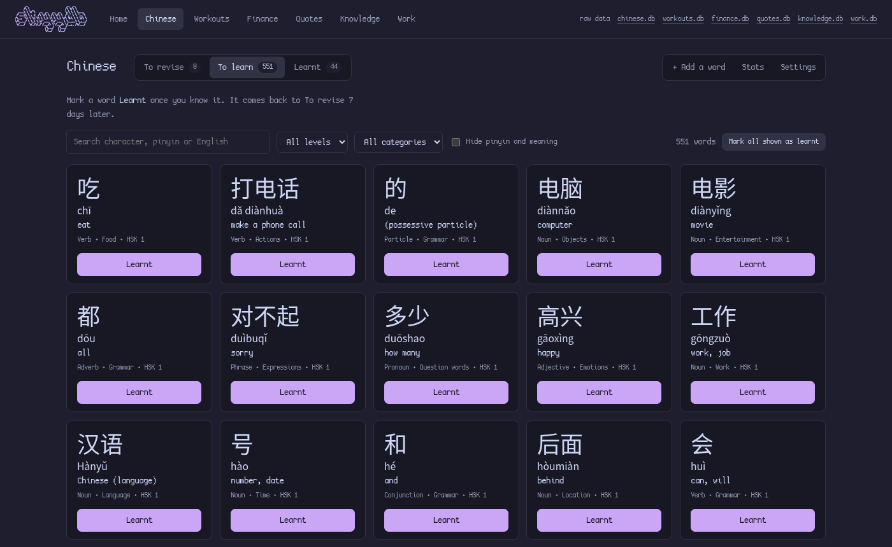
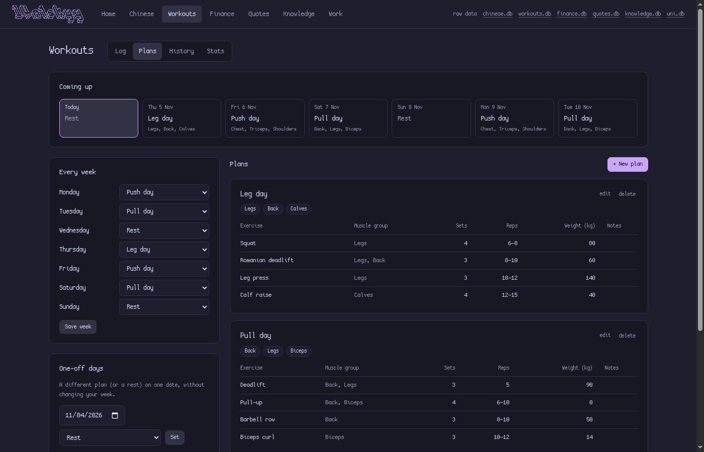
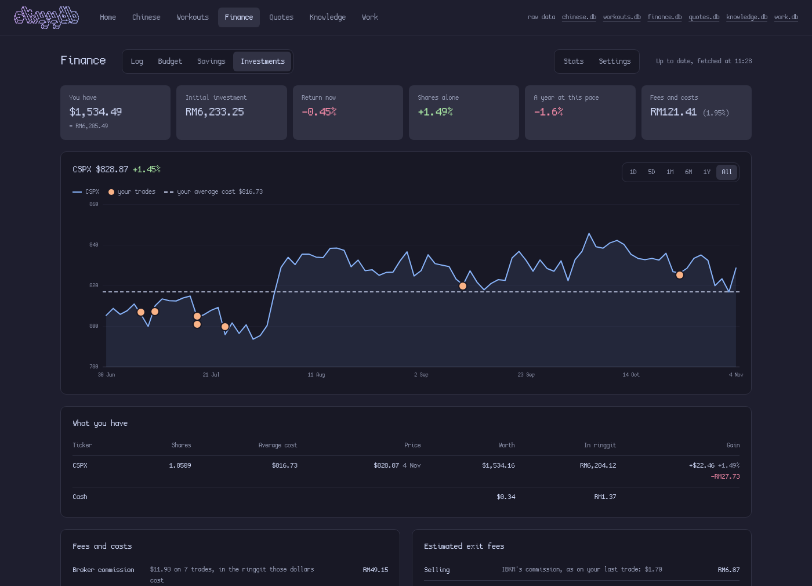
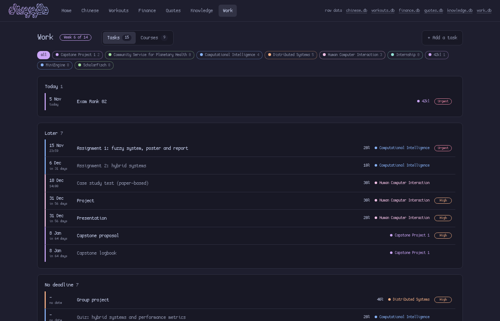

# ⛈️ skyydb

A small local web app for personal trackers, each a SQLite database, fully local and runs on your own computer at http://127.0.0.1:8001. Last time I used google sheets, but don't really feel comfortable having allat online yknow.

Choose what you like, leave what you dont 😛 also p.s. lowkey vibecoded but still useful la

ALSO! fun fact, can connect ibkr and wise api directly to investments page. And quotes are fetched from ZenQuotes through api too.

<div align="center">
  <h4>Built with ❤️ by <b>l4n1skyy (and mr. claude)</b></h4>
</div>

## Table of contents

- [Install](#install)
  - [1. Requirements](#1-requirements)
  - [2. Datasette](#2-datasette)
  - [3. skyydb](#3-skyydb)
- [Choose your features](#choose-your-features)
- [Run it](#run-it)
- [Commands](#commands)



| Chinese | Workouts |
|---|---|
|  |  |

| Finance | Work |
|---|---|
|  |  |

| Quotes |
|---|
|  |

## Install

### 1. Requirements

Linux, Python 3.11+, SQLite and `xdg-utils` (it opens your browser). A CJK font (`noto-fonts-cjk`) is needed for Chinese characters. On Arch:

```bash
sudo pacman -S --needed python sqlite xdg-utils noto-fonts-cjk
```

### 2. Datasette

skyydb needs Datasette **1.0a41**, and the `datasette` command must end up on your PATH. Any one of these works:

```bash
# uv (sudo pacman -S uv)
uv tool install --prerelease=allow 'datasette==1.0a41'

# pipx
pipx install --pip-args=--pre 'datasette==1.0a41'

# plain pip, in a virtual environment
python -m venv ~/.venvs/datasette
~/.venvs/datasette/bin/pip install --pre 'datasette==1.0a41'
ln -s ~/.venvs/datasette/bin/datasette ~/.local/bin/datasette
```

### 3. skyydb

Clone it wherever you want your data to live: the databases and `backups/` are created inside this folder and stay out of git.

```bash
git clone https://github.com/l4n1skyy/skyydb.git
cd skyydb
ln -s "$PWD/bin/skyydb" ~/.local/bin/skyydb   # any folder on your PATH works
```

## Choose your features

The features are `chinese`, `workouts`, `finance`, `work`, `quotes` and `knowledge`. Install just the ones you want:

```bash
skyydb install finance workouts chinese
```

Only those get a database, a page and a spot on the dashboard. Leave the names out to install everything. Run it again any time to change the choice: the data of a feature you drop stays in its file, just hidden. `skyydb features` shows what's installed.

## Run it

```bash
skyydb             # starts the app and opens http://127.0.0.1:8001 in your browser
skyydb autostart   # optional: start it whenever you log in (skyydb autostart off undoes it)
```

## Commands

| Command | What it does |
|---|---|
| `skyydb` | Starts the app if needed, backs up the databases and opens the browser |
| `skyydb install [features]` | Chooses which features are installed (no names = all) |
| `skyydb features` | Lists which features are installed |
| `skyydb status` | Shows whether it's running and a summary of your data |
| `skyydb import FILE` | Imports Chinese words from a CSV, or finance data from Google Sheets exports |
| `skyydb backup` | Copies the databases into `backups/` (also done once a day, keeping 14) |
| `skyydb restart` / `skyydb stop` | Restarts or stops the app (restart after editing `plugins/app.py`) |
| `skyydb autostart` | Starts the app at login (`skyydb autostart off` undoes it) |
